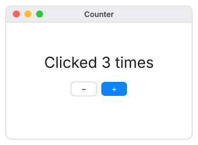

# Build a counter

In this tutorial you'll build a counter app from an empty file, one small step at a
time. Each step runs, so you can see what every line does.

**You'll learn:** windows, labels, buttons, state, and how the screen updates itself.



## Step 0: An empty project

Make a folder called `counter` with an empty file `main.nf` inside:

```bash
mkdir counter
touch counter/main.nf
```

Open `counter/main.nf` in your editor. Run the app after each step with:

```bash
nf run counter
```

## Step 1: A window

Every Nifty app needs at least one window. Type this:

```nf
window("Counter") {
}
```

Run it. You get an empty window titled **Counter**.

- `window(...)` is an **element**: a built-in piece of UI.
- `"Counter"` is the window's title.
- The `{ }` after it holds what goes *inside* the window. It's empty for now.

## Step 2: Some text

Put a `label` inside the window:

```nf
window("Counter") {
  label("Hello!")
}
```

Run it. The window now says **Hello!**

## Step 3: A size

The window is bigger than it needs to be. Give it a size in *points* (the unit macOS
uses for screen sizes):

```nf
window("Counter", width: 320, height: 200) {
  label("Hello!")
}
```

`width: 320` is a **named argument**: you say which setting you mean, then its value.
Named arguments always come after the unnamed ones like `"Counter"`.

## Step 4: Remember a number

Now the important part. Add a line at the very top:

```nf
state count = 0

window("Counter", width: 320, height: 200) {
  label("Clicked {count} times")
}
```

- `state count = 0` makes a piece of **state** called `count` that starts at `0`.
  State is the data your app remembers while it runs.
- Inside the text, `{count}` is replaced by the value of `count`. This is called
  **interpolation**. You can put any expression in the braces, like `{count * 2}`.

Run it: **Clicked 0 times**.

## Step 5: A button

Add a button under the label. Because there are now two things in the window, wrap
them in a `column`, which stacks things top to bottom:

```nf
state count = 0

window("Counter", width: 320, height: 200) {
  column() {
    label("Clicked {count} times")
    button("+") { count += 1 }
  }
}
```

Run it and click **+** a few times. The number goes up!

Look at what you *didn't* write. There's no "when the button is clicked, find the label
and change its text" code. You only said:

- the label shows `count`, and
- the button adds 1 to `count`.

Nifty connects the two. When `count` changes, every part of the screen that uses
`count` updates. (Curious how? See [How the UI stays up to date](../guide/updates.md).)

> **Watch out:** elements always need parentheses, even with nothing inside them.
> Write `column() { … }`, not `column { … }`.

## Step 6: A minus button

Put the two buttons side by side in a `row`:

```nf
state count = 0

window("Counter", width: 320, height: 200) {
  column() {
    label("Clicked {count} times")
    row() {
      button("−") { count -= 1 }
      button("+") { count += 1 }
    }
  }
}
```

`count -= 1` means "take 1 away from `count`". There are also `*=` and `/=`.

## Step 7: Make it look nice

Finally, add some spacing, center everything, use a big title style for the number,
and make **+** the main button:

```nf
{{#include ../../../examples/counter/main.nf}}
```

What's new:

| Setting | What it does |
|---|---|
| `spacing: 12` | 12 points of space between children. |
| `align: .center` | Centers children across the column (left to right). |
| `justify: .center` | Centers children along the column (top to bottom). |
| `style: .title` | Big, bold title text. |
| `style: .primary` | Makes the button the main action: it's drawn in the system's accent color, and pressing **Return** clicks it. |

The values that start with a dot, like `.center`, are **options**. Each setting has its
own small list of options; the [UI elements reference](../reference/elements.md) lists
them all.

## You did it

That's the same counter as in [`examples/counter`](../examples/counter.md). Some things
to try on your own:

- Add a **Reset** button that sets `count = 0`.
- Show a second label with `"Doubled: {count * 2}"`.
- Show a message only when the count is high:

  ```nf
  if count >= 10 {
    label("That's a lot of clicks!", style: .caption)
  }
  ```

Ready for more? [Build a todo list](todos.md) next.
