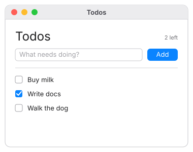

# Build a todo list

This tutorial builds a todo list: type a task, add it, tick it off, and see how many are
left. It picks up where [Build a counter](counter.md) left off.

**You'll learn:** structs, lists, text fields, checkboxes, `for` loops, functions and
your own views.



Create a new project to work in:

```bash
mkdir todos
touch todos/main.nf
```

## Step 1: Describe a todo

A todo has two parts: its title, and whether it's done. In Nifty you describe a shape
of data like that with a **struct**:

```nf
struct Todo {
  title: string
  done: bool
}
```

This says: "a `Todo` has a `title`, which is text (`string`), and `done`, which is
`true` or `false` (`bool`)."

A struct is only a description. To make an actual todo, you call it like a function,
naming each field:

```nf
Todo(title: "Buy milk", done: false)
```

## Step 2: A list of todos

The app needs to remember a list of todos. Add this under the struct:

```nf
state todos: [Todo] = []
```

- `[Todo]` means "a list of `Todo`s".
- `= []` means it starts empty.

Why write the type here, when `state count = 0` didn't need one? Because Nifty can tell
`0` is a number, but it can't tell what an empty list `[]` will hold. So you say.

## Step 3: Show the list

Add a window that shows every todo, using `for`:

```nf
struct Todo {
  title: string
  done: bool
}

state todos: [Todo] = [
  Todo(title: "Buy milk", done: false),
  Todo(title: "Write docs", done: true),
]

window("Todos", width: 360, height: 480) {
  column(spacing: 12, padding: 20) {
    for todo in todos {
      label(todo.title)
    }
  }
}
```

We started the list with two todos so there's something to see. `for todo in todos`
repeats its block once for every item; each time, `todo` is the current item.
`todo.title` reads the item's `title` field.

Run it and you'll see both titles.

## Step 4: Checkboxes

Replace the `label` with a checkbox that's ticked when the todo is done:

```nf
    for todo in todos {
      checkbox(checked: $todo.done, title: todo.title)
    }
```

Notice the `$` in `$todo.done`. That's a **two-way binding**:

- The checkbox *shows* whether `todo.done` is true, **and**
- when you click the checkbox, it *changes* `todo.done`.

Without `$`, the checkbox could only show a value, never change it. Run the app and tick
some boxes. (More in [Two-way bindings](../guide/bindings.md).)

## Step 5: Typing new todos

To add todos we need somewhere to type. Add a second piece of state for the text being
typed, and a text field bound to it. Start the list empty again, too:

```nf
state todos: [Todo] = []
state draft = ""
```

And at the top of the column:

```nf
    row(spacing: 8) {
      text_field($draft, placeholder: "What needs doing?")
      button("Add", style: .primary) { add_todo() }
    }
    divider()
```

- `text_field($draft, …)` shows `draft` and updates it as you type.
- The placeholder is the grey hint shown while the field is empty.
- `divider()` draws a line.
- The button calls `add_todo()`, a function we'll write next.

## Step 6: A function to add todos

Put this function anywhere at the top level of the file (outside the window):

```nf
fn add_todo() {
  if draft != "" {
    todos.push(Todo(title: draft, done: false))
    draft = ""
  }
}
```

Read it out loud: *"To add a todo: if the draft isn't empty, push a new todo with that
title onto the list, then clear the draft."*

- `fn` declares a function.
- `!=` means "is not equal to".
- `todos.push(…)` adds an item to the end of the list.
- `draft = ""` empties the text field, because the field is bound to `draft`.

Run it. Type something, click **Add** (or press **Return**, since it's the primary
button), and your todo appears.

## Step 7: Count what's left

Let's show how many todos aren't done. Add a function that counts them and **returns**
the answer:

```nf
fn remaining() -> int {
  let count = 0
  for todo in todos {
    if !todo.done {
      count += 1
    }
  }
  return count
}
```

- `-> int` says this function gives back a whole number.
- `let count = 0` makes a local variable that only exists while the function runs.
- `!todo.done` means "not done".
- `return count` hands the answer back.

## Step 8: Your own view

The header will show a title on the left and the count on the right. You could write
that inline, but giving it a name keeps the window tidy. A **view** is a reusable piece
of UI you define yourself:

```nf
view Header(left: int) {
  row(align: .center) {
    label("Todos", style: .title)
    spacer()
    label("{left} left", style: .caption)
  }
}
```

`spacer()` takes up all the free space, pushing the count to the right edge. Use the
view like any built-in element:

```nf
    Header(left: remaining())
```

The header updates automatically whenever a todo is added or ticked, because
`remaining()` reads `todos`, and Nifty notices that.

## The finished app

Here's everything together. It's the same as
[`examples/todos`](../examples/todos.md):

```nf
{{#include ../../../examples/todos/main.nf}}
```

## Try this next

- Show a message when the list is empty: `if todos.is_empty() { label("All clear!") }`
- Add a **Clear all** button that sets `todos = []`.
- Show the total: `label("{todos.len()} total", style: .caption)`.

Now you know almost all of Nifty! The [guide](../guide/values.md) explains each idea in
more depth, and the [cheat sheet](../reference/cheat-sheet.md) fits it all on one page.
